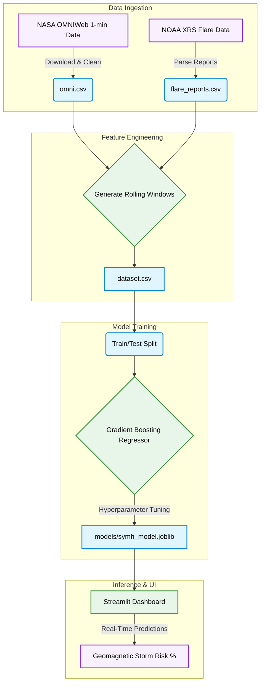

# SolarWind Forecaster

A data science pipeline and Scikit-learn Gradient Boosting model for 15-minute forecasting of geomagnetic storm risk from NASA/NOAA datasets.

> **Live Deployments:**
> * **Interactive Streamlit App:** [solarwind-forecaster.streamlit.app](https://solarwind-forecaster.streamlit.app/)

---

## Overview

SolarWind Forecaster is a space weather analytics system designed to predict short-term geomagnetic storm disturbances ($Sym\text{-}H$ index) 15 minutes in advance. Ingesting solar wind magnetic field telemetry and plasma parameters from NASA OMNIWeb alongside solar flare observations from NOAA GOES XRS, the pipeline computes rolling statistical windows and temporal lag indicators to train an ensemble Gradient Boosting regressor. An interactive Streamlit dashboard enables researchers to visualize geomagnetic risks and analyze real-time storm probability curves.

---

## Architecture Overview



---

## Features

| Feature | Description |
| ------- | ----------- |
| **Space Weather Ingestion** | Automated parsers for high-cadence 1-minute NASA OMNI interplanetary magnetic field (IMF) and plasma datasets |
| **Temporal Lag Engineering** | Generates 15-minute and 60-minute rolling window statistics (mean, variance, min/max) capturing solar shock wave transitions |
| **Gradient Boosting Core** | Scikit-learn ensemble regression tuned against multi-decade solar cycle historical records |
| **Exploratory Visualizations** | Interactive Streamlit interface displaying real-time predictions, historical storm distributions, and feature importance rankings |
| **Pipeline Automation** | Automated Makefile workflows and continuous integration suites via GitHub Actions |

---

## Technology Stack

| Component | Technologies |
| :-------- | :----------- |
| **Machine Learning** | `Scikit-learn` (GradientBoostingRegressor), `Joblib` |
| **Data Engineering** | `Pandas`, `NumPy`, `SciPy` |
| **Visualizations** | `Matplotlib`, `Seaborn`, `Streamlit` |
| **Automation & CI** | `Makefile`, `pytest`, `ruff`, GitHub Actions CI |

---

## Project Structure

```
SolarWind-Forecaster/
├── configs/                    # Pipeline configuration files
├── models_deploy/              # Serialized model weights and training metadata
├── notebooks/                  # Exploratory Data Analysis and evaluation notebooks
├── reports/                    # Model validation reports and plots
├── scripts/                    # Space weather data fetchers and mock generators
├── src/                        # Production pipeline modules
│   ├── data_ingestion.py       # NASA/NOAA dataset download and parsing
│   ├── feature_engineering.py  # Rolling windows and temporal lag computation
│   ├── data_sharding.py        # Time-series cross-validation sharding
│   ├── model_training.py       # Model training loop and hyperparameter optimization
│   ├── model_inference.py      # Real-time inference wrappers
│   └── experiments/            # Exploratory research experiments
├── tests/                      # Automated test suite
├── app.py                      # Streamlit interactive dashboard
├── Makefile                    # Automation targets (data, features, train, dashboard)
├── requirements.txt            # Python dependencies
├── ruff.toml                   # Code linting configuration
└── README.md
```

---

## Setup and Installation

### Prerequisites

- Python 3.11+
- `make` utility (optional, for automation shortcuts)

### 1. Clone the repository

```bash
git clone https://github.com/Shashank17singh/SolarWind-Forecaster.git
cd SolarWind-Forecaster
```

### 2. Install dependencies

```bash
pip install -r requirements.txt
```

### 3. Run pipeline steps

Execute the end-to-end data pipeline using the Makefile:

```bash
# 1. Download and parse raw NASA/NOAA telemetry
make data

# 2. Extract rolling time-series features and lags
make features

# 3. Shard dataset and train Gradient Boosting model
make train
```

### 4. Launch the dashboard

Launch the Streamlit visualization interface:

```bash
make dashboard
# Or directly:
streamlit run app.py
```

Open `http://localhost:8501` in your browser.

---

## Running the Tests

Execute automated unit tests with pytest:

```bash
pytest tests/
```

Run static code analysis and linting:

```bash
ruff check .
```

---

## Deployment

Live deployment is hosted on Streamlit Community Cloud at [solarwind-forecaster.streamlit.app](https://solarwind-forecaster.streamlit.app/).

Continuous Integration is enforced via `.github/workflows/ci.yml`, running automated unit tests and code validation on every push.

---

## Known Limitations

- Real-time prediction accuracy relies on continuous interplanetary satellite telemetry (ACE / DSCOVR); data stream dropouts require fallback imputation strategies.
- The 15-minute prediction horizon provides tactical alert capability; longer multi-hour forecasting requires incorporating coronal mass ejection (CME) kinematic propagation models.

---

## License

This project is licensed under the MIT License. See [LICENSE](LICENSE) for details.
